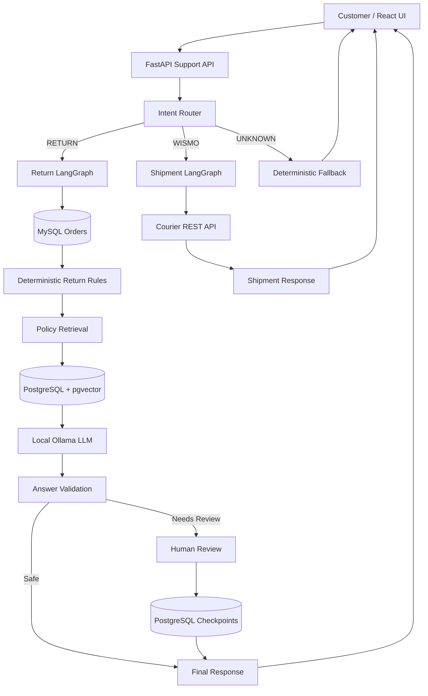

# Returns Copilot

A local-first AI customer support application that routes customer requests across return eligibility, shipment tracking, and unsupported queries.

The project combines deterministic business rules, Retrieval-Augmented Generation (RAG), LangGraph workflows, human-in-the-loop review, PostgreSQL checkpointing, REST API integration, structured logging, and a React frontend.

The system is designed so that the LLM explains business decisions rather than making high-risk decisions itself.

---

## What the system does

The assistant currently supports three request types:

### 1. Return requests

For return-related questions, the system:

1. Retrieves order information from MySQL.
2. Applies deterministic return eligibility rules.
3. Retrieves relevant policy evidence from PostgreSQL with pgvector.
4. Generates a grounded customer-facing explanation using a local LLM.
5. Validates the generated answer against structured order facts.
6. Routes low-confidence or problematic responses to human review.
7. Persists interrupted workflows using PostgreSQL-backed LangGraph checkpoints.

### 2. Shipment tracking

For "Where is my order?" requests, the system:

1. Routes the request to the shipment workflow.
2. Calls a mock courier REST API.
3. Handles transient failures with retry logic.
4. Produces a customer-facing shipment update.

If the courier service is unavailable, the application returns a deterministic fallback rather than failing the entire request.

### 3. Unsupported requests

Questions outside the supported return and shipment domains are routed to a deterministic fallback response rather than being passed freely to the LLM.

---

## Architecture



---

## Design principles

### Deterministic decisions before generation

The LLM does not decide whether an order is eligible for return.

Return eligibility is calculated using application business logic based on structured fields such as:

- delivery date
- item condition
- final-sale status

The LLM receives the resulting decision and explains it to the customer.

This separates:

```text
Business decision
        ↓
Deterministic application logic

Customer explanation
        ↓
LLM + retrieved evidence
```

### RAG as supporting evidence

Policy retrieval is used to support and cite the explanation.

Retrieved policy text does not establish order-specific facts. Structured order data remains the source of truth for facts such as whether an item is final sale or whether it was used.

### Human-in-the-loop review

Responses can be paused when confidence is below the configured human-review threshold or when answer validation detects a problem.

A reviewer can:

- approve the generated draft
- edit and approve the draft
- reject the response

LangGraph checkpointing allows the workflow to pause and later resume using the same thread ID.

### Graceful degradation

External service failure does not automatically crash the user workflow.

For example, if the courier API is unavailable, the shipment workflow returns a controlled fallback response.

---

## Technology stack

### Backend

- Python
- FastAPI
- LangGraph
- SQLAlchemy
- MySQL
- PostgreSQL
- pgvector
- psycopg
- PyMySQL
- HTTPX
- pytest

### AI / Retrieval

- Ollama
- Qwen3 4B Instruct
- Sentence Transformers
- `all-MiniLM-L6-v2`
- semantic vector retrieval
- BM25 experimentation
- cross-encoder reranking experimentation

### Frontend

- React
- Vite
- JavaScript
- CSS

### Infrastructure

- Docker Compose
- MySQL 8.4
- PostgreSQL 16 with pgvector

---

## Repository structure

```text
returns-copilot/
│
├── backend/
│   ├── app.py
│   ├── config.py
│   ├── courier_app.py
│   ├── courier_client.py
│   ├── database.py
│   ├── intent_classifier.py
│   ├── returns_logic.py
│   ├── services.py
│   │
│   ├── rag/
│   │   ├── embeddings.py
│   │   ├── ingestion.py
│   │   ├── ollama_client.py
│   │   ├── pgvector_search.py
│   │   ├── rag_pipeline.py
│   │   ├── hybrid_search.py
│   │   └── reranker.py
│   │
│   └── workflow/
│       ├── order_return_graph.py
│       ├── shipment_status_graph.py
│       ├── support_router_graph.py
│       └── checkpoint_database.py
│
├── data/
│   └── policies/
│       ├── uk_returns.md
│       ├── eu_returns.md
│       └── product_care.md
│
├── eval/
│   ├── intent_cases.json
│   ├── rag_answer_cases.json
│   ├── rag_negative_cases.json
│   ├── rag_retrieval_cases.json
│   ├── run_intent_eval.py
│   ├── run_rag_answer_eval.py
│   ├── run_rag_retrieval_eval.py
│   ├── run_hybrid_retrieval_eval.py
│   ├── run_reranker_eval.py
│   └── run_threshold_eval.py
│
├── frontend/
│   ├── src/
│   │   ├── App.jsx
│   │   ├── App.css
│   │   ├── index.css
│   │   └── main.jsx
│   ├── package.json
│   └── vite.config.js
│
├── tests/
│   ├── test_courier_client.py
│   ├── test_returns_api.py
│   ├── test_support_api.py
│   └── test_support_router.py
│
├── .env.example
├── docker-compose.yml
├── pytest.ini
├── requirements.txt
└── README.md
```

---

## Local setup

### Prerequisites

Install:

- Python 3.12+
- Docker Desktop
- Ollama
- Node.js and npm
- Git

---

### 1. Clone the repository

```bash
git clone https://github.com/abhinav322/returns-copilot.git
cd returns-copilot
```

---

### 2. Create the Python environment

On Windows:

```powershell
python -m venv .venv
.venv\Scripts\Activate.ps1
```

Install the Python dependencies:

```powershell
python -m pip install -r requirements.txt
```

---

### 3. Configure environment variables

Copy:

```text
.env.example
```

to:

```text
.env
```

and replace the example development passwords with your local values.

For the frontend, copy:

```text
frontend/.env.example
```

to:

```text
frontend/.env
```

---

### 4. Start MySQL and PostgreSQL

```powershell
docker compose up -d
```

Verify:

```powershell
docker compose ps
```

---

### 5. Create and seed the application database

```powershell
python -m backend.create_tables
python -m backend.seed_data
```

---

### 6. Prepare the vector database

Create the pgvector-backed policy table:

```powershell
python -m backend.rag.create_vector_tables
```

Ingest the sample policy documents:

```powershell
python -m backend.rag.ingest_to_pgvector
```

---

### 7. Prepare LangGraph checkpoints

```powershell
python -m backend.workflow.setup_checkpoints
```

---

### 8. Install the local language model

The project uses Ollama with:

```text
qwen3:4b-instruct
```

Pull the model:

```powershell
ollama pull qwen3:4b-instruct
```

Make sure Ollama is running before starting the backend.

---

## Running the application

The complete local application uses three processes.

### Main FastAPI application

From the repository root:

```powershell
python -m uvicorn backend.app:app --reload --port 8000
```

Main API:

```text
http://127.0.0.1:8000
```

---

### Mock courier API

Open another terminal:

```powershell
python -m uvicorn backend.courier_app:app --reload --port 8001
```

Courier API:

```text
http://127.0.0.1:8001
```

---

### React frontend

Open another terminal:

```powershell
cd frontend
npm install
npm run dev
```

Frontend:

```text
http://localhost:5173
```

---

## Example requests

### Return eligibility

```text
Order number: ORD-1001
Question: Can I return this item?
```

The workflow evaluates structured order data, retrieves relevant return policy evidence, validates the generated explanation, and may request human review when confidence is low.

### Shipment tracking

```text
Order number: ORD-2001
Question: Where is my order?
```

The router sends the request to the shipment workflow, which calls the courier REST service.

### Unsupported request

```text
Order number: ORD-1001
Question: Do you offer gift cards?
```

The router classifies the request as unsupported and returns a controlled fallback.

---

## Human review workflow

A return response may enter:

```text
pending_review
```

The frontend displays:

- the generated draft
- validation issues
- retrieved policy sources
- the workflow thread ID

A reviewer can edit and approve the answer.

The workflow then resumes from the PostgreSQL checkpoint instead of restarting from the beginning.

---

## Evaluation

The project includes dedicated evaluation scripts rather than relying only on manual testing.

### Intent classification

Curated evaluation set:

```text
21 / 21 cases passed
```

The set contains return, shipment/WISMO, and unsupported requests.

This is an evaluation result on the included curated dataset and should not be interpreted as general production accuracy.

### Semantic retrieval

Current semantic retrieval evaluation:

```text
Top-1 accuracy: 90.91%
Hit@3:           100.00%
MRR:             0.9545
```

### RAG answer evaluation

Current answer evaluation:

```text
7 / 7 cases passed
Grounded answers: 4 / 4
Abstentions:      3 / 3
```

The answer evaluator is heuristic and does not represent full semantic entailment evaluation.

### Retrieval experiments

The repository also contains experiments with:

- BM25 + semantic hybrid retrieval
- Reciprocal Rank Fusion
- cross-encoder reranking
- relevance-threshold calibration

These experiments were evaluated rather than automatically promoted into the production path.

For the current dataset, the simpler semantic retrieval approach remained the production choice.

---

## Relevance and human-review thresholds

The application separates two different confidence concepts:

```text
RAG_RELEVANCE_THRESHOLD=0.50
HUMAN_REVIEW_THRESHOLD=0.70
```

The relevance threshold determines whether retrieved evidence is sufficiently relevant to use.

The human-review threshold determines whether the generated result should require reviewer approval.

These thresholds intentionally serve different purposes.

---

## Reliability and safety controls

The application includes several safeguards:

- deterministic return eligibility
- retrieval relevance filtering
- citation validation
- order-fact consistency checks
- human review for low-confidence responses
- persistent workflow checkpoints
- courier retry handling
- deterministic service-failure fallbacks
- unsupported-intent fallback
- sanitized API error responses
- request IDs for tracing
- structured JSON application logging

The answer validator is deliberately lightweight and rule-based. It is not presented as a complete semantic hallucination detector.

---

## Testing

Run the backend test suite from the repository root:

```powershell
python -m pytest -v
```

Current project test suite:

```text
20 tests passing
```

Tests cover areas including:

- return APIs
- support routing
- courier client behavior
- support API behavior

---

## Frontend quality checks

From:

```text
frontend/
```

run:

```powershell
npm run lint
```

and:

```powershell
npm run build
```

The current frontend passes both ESLint and the Vite production build.

---

## Observability

Each HTTP request receives a request ID.

The backend emits structured JSON logs containing fields such as:

```text
request_id
method
path
status_code
duration_ms
order_number
thread_id
intent
workflow_status
```

The workflow thread ID and HTTP request ID are intentionally separate:

- `request_id` traces an individual HTTP request
- `thread_id` identifies a persistent LangGraph workflow across multiple HTTP requests

This allows a human-review resume request to have a new request ID while continuing the same workflow thread.

---

## Important implementation choice

One failure discovered during end-to-end testing involved a retrieved "Final Sale" policy chunk.

The order itself was **not** a final-sale item, but the language model transformed the general policy text into an incorrect order-specific claim.

The system prevented automatic release through human review.

The workflow was then strengthened with two layers of protection:

1. Prompt rules explicitly separate retrieved policy from structured order facts.
2. Deterministic validation checks generated claims against known order fields.

This is an example of why RAG alone does not guarantee grounded generation.

---

## Current limitations

This project is a local demonstration system rather than a production commerce platform.

Current limitations include:

- synthetic/sample order data
- mock courier service
- no customer authentication or authorization
- no customer ownership validation for order numbers
- heuristic answer validation rather than full semantic entailment
- small curated evaluation datasets
- local Ollama inference rather than a horizontally scaled model service

These limitations are intentionally documented rather than hidden.

---

## Future improvements

Potential extensions include:

- authentication and customer/order authorization
- semantic/NLI-based answer verification
- production-grade model serving
- distributed tracing
- outbound request-ID propagation
- larger retrieval and generation evaluation datasets
- CI/CD validation
- containerized backend and frontend services
- cloud deployment

---

## Why this project exists

This project explores how an AI support workflow can combine:

```text
LLM flexibility
+
deterministic business rules
+
retrieval grounding
+
workflow orchestration
+
human oversight
+
observable APIs
```

rather than treating an LLM as an unrestricted decision-maker.

---

## Author

**Abhinav Mondal**

MSc Business Analytics & Decision Sciences
University of Leeds