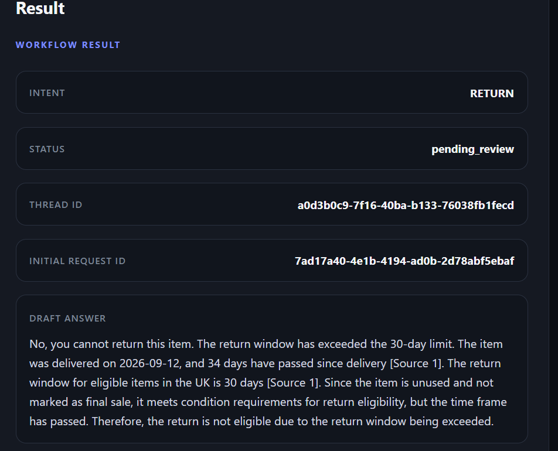
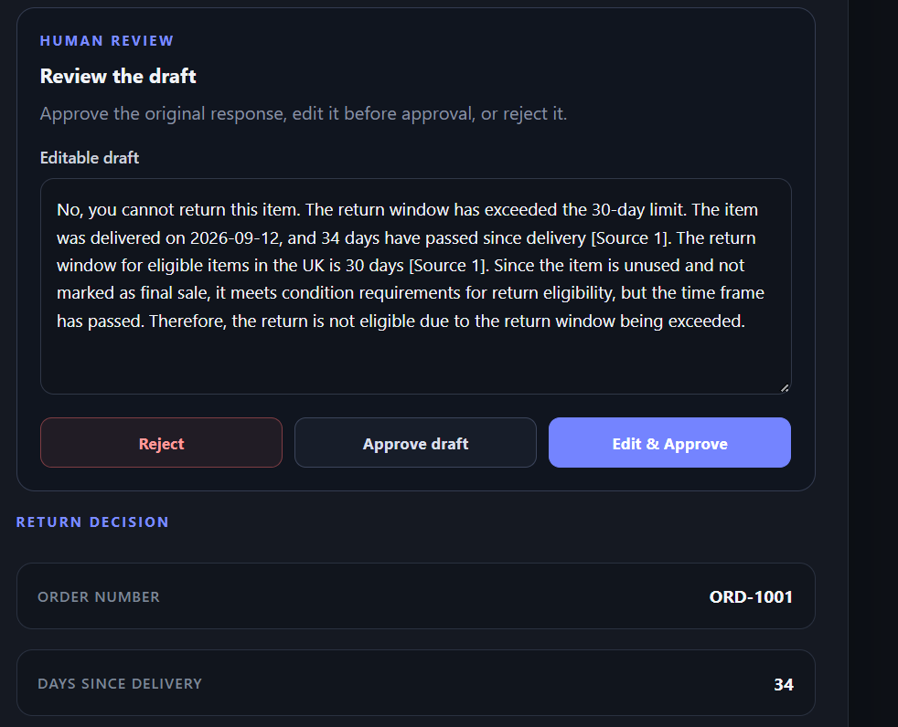
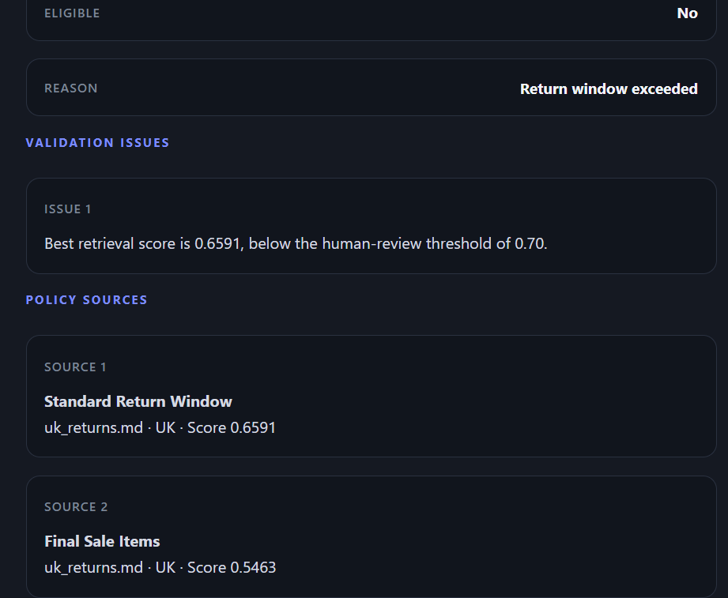
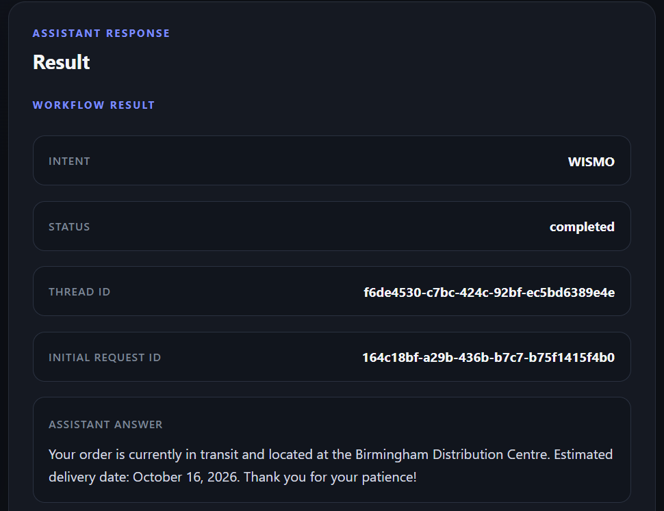
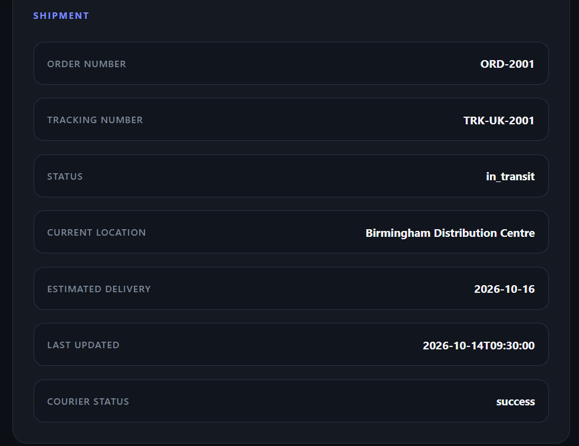
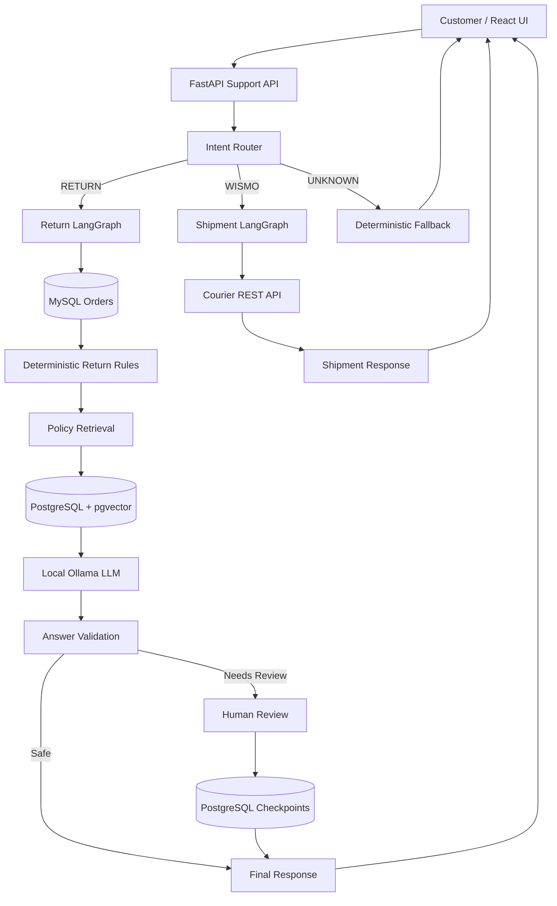

# Returns Copilot

[](https://github.com/abhinav322/returns-copilot/actions/workflows/ci.yml)

**Local-first GenAI customer support copilot with RAG, LangGraph, human-in-the-loop review, pgvector, FastAPI, Ollama, and React.**

**CI status:** passing on `main` with automated frontend lint/build and backend tests.

A customer-support application that routes customer requests across return eligibility, shipment tracking, and unsupported queries.

The system combines deterministic business rules, Retrieval-Augmented Generation (RAG), LangGraph workflows, human-in-the-loop review, PostgreSQL checkpointing, REST API integration, structured logging, automated evaluation, and a React frontend.

A core design principle is that the LLM explains business decisions rather than making high-risk decisions itself.

---

## Demo

### Return workflow with human review

The return workflow evaluates structured order data first, retrieves supporting policy evidence, generates a draft response, validates that response against known order facts, and pauses for human review when confidence or validation checks require it.



The reviewer can reject the response, approve it unchanged, or edit it before approval.



The UI also exposes the deterministic decision, validation issues, retrieval confidence, and supporting policy sources.



### Shipment tracking workflow

Shipment questions are routed separately to the WISMO workflow.

The assistant calls the courier service and returns a customer-facing update.



Structured shipment information remains visible alongside the generated response.



---

## What the system does

The assistant currently supports three request types.

### Return requests

For return-related questions, the system:

1. Retrieves order information from MySQL.
2. Applies deterministic return eligibility rules.
3. Retrieves relevant policy evidence from PostgreSQL with pgvector.
4. Generates a grounded customer-facing explanation using a local LLM.
5. Validates the generated answer against structured order facts.
6. Routes low-confidence or problematic responses to human review.
7. Persists interrupted workflows using PostgreSQL-backed LangGraph checkpoints.

### Shipment tracking

For "Where is my order?" requests, the system:

1. Routes the request to the shipment workflow.
2. Calls a mock courier REST API.
3. Handles transient failures with retry logic.
4. Produces a customer-facing shipment update.

If the courier service is unavailable, the application returns a controlled deterministic fallback rather than failing the entire request.

### Unsupported requests

Questions outside the supported return and shipment domains are routed to a deterministic fallback response rather than being passed freely to the LLM.

---

## Architecture



---

## Design principles

### Deterministic decisions before generation

The LLM does not decide whether an order is eligible for return.

Return eligibility is calculated using application business logic based on structured fields such as delivery date, item condition, and final-sale status.

The LLM receives the resulting decision and explains it to the customer.

```text
Business decision
        ↓
Deterministic application logic

Customer explanation
        ↓
LLM + retrieved evidence
```

### RAG as supporting evidence

Policy retrieval supports and cites the explanation.

Retrieved policy text does not establish order-specific facts.

Structured order data remains the source of truth for facts such as:

```text
final-sale status
item condition
delivery date
return eligibility result
```

This prevents a retrieved policy section from being treated as evidence that a specific order has that property.

### Human-in-the-loop review

Responses can be paused when retrieval confidence is below the configured human-review threshold or answer validation detects a problem.

A reviewer can approve the generated draft, edit and approve it, or reject the response.

LangGraph checkpointing allows the workflow to pause and later resume using the same thread ID.

### Graceful degradation

External service failure does not automatically crash the user workflow.

For example, if the courier API is unavailable, the shipment workflow returns a controlled fallback response.

---

## Technology stack

### Backend

```text
Python
FastAPI
LangGraph
SQLAlchemy
MySQL
PostgreSQL
pgvector
psycopg
PyMySQL
HTTPX
pytest
```

### AI and retrieval

```text
Ollama
Qwen3 4B Instruct
Sentence Transformers
all-MiniLM-L6-v2
semantic vector retrieval
BM25 experimentation
cross-encoder reranking experimentation
```

### Frontend

```text
React
Vite
JavaScript
CSS
```

### Infrastructure

```text
Docker Compose
MySQL 8.4
PostgreSQL 16 + pgvector
GitHub Actions
```

---

## Repository structure

```text
returns-copilot/
│
├── .github/
│   └── workflows/
│       └── ci.yml
│
├── backend/
│   ├── app.py
│   ├── config.py
│   ├── courier_app.py
│   ├── courier_client.py
│   ├── database.py
│   ├── intent_classifier.py
│   ├── returns_logic.py
│   ├── services.py
│   │
│   ├── rag/
│   │   ├── embeddings.py
│   │   ├── ingestion.py
│   │   ├── ollama_client.py
│   │   ├── pgvector_search.py
│   │   ├── rag_pipeline.py
│   │   ├── hybrid_search.py
│   │   └── reranker.py
│   │
│   └── workflow/
│       ├── order_return_graph.py
│       ├── shipment_status_graph.py
│       ├── support_router_graph.py
│       └── checkpoint_database.py
│
├── data/
│   └── policies/
│       ├── uk_returns.md
│       ├── eu_returns.md
│       └── product_care.md
│
├── docs/
│   └── images/
│       ├── return-result.png
│       ├── return-review.png
│       ├── return-validation.png
│       ├── shipment-result.png
│       └── shipment-details.png
│
├── eval/
│   ├── intent_cases.json
│   ├── rag_answer_cases.json
│   ├── rag_negative_cases.json
│   ├── rag_retrieval_cases.json
│   ├── run_intent_eval.py
│   ├── run_rag_answer_eval.py
│   ├── run_rag_retrieval_eval.py
│   ├── run_hybrid_retrieval_eval.py
│   ├── run_reranker_eval.py
│   └── run_threshold_eval.py
│
├── frontend/
│   ├── src/
│   │   ├── App.jsx
│   │   ├── App.css
│   │   ├── index.css
│   │   └── main.jsx
│   ├── package.json
│   └── vite.config.js
│
├── tests/
│   ├── test_answer_validation.py
│   ├── test_courier_client.py
│   ├── test_returns_api.py
│   ├── test_support_api.py
│   └── test_support_router.py
│
├── .env.example
├── docker-compose.yml
├── pytest.ini
├── requirements.txt
└── README.md
```

---

## Local setup

### Prerequisites

Install Python 3.12+, Docker Desktop, Ollama, Node.js, npm, and Git.

### 1. Clone the repository

```bash
git clone <repository-url>
cd returns-copilot
```

### 2. Create the Python environment

On Windows:

```powershell
python -m venv .venv
.venv\Scripts\Activate.ps1
```

Install dependencies:

```powershell
python -m pip install -r requirements.txt
```

### 3. Configure environment variables

Copy:

```text
.env.example
```

to:

```text
.env
```

and replace the example development passwords with your local values.

For the frontend, copy:

```text
frontend/.env.example
```

to:

```text
frontend/.env
```

### 4. Start MySQL and PostgreSQL

```powershell
docker compose up -d
```

Verify:

```powershell
docker compose ps
```

### 5. Create and seed the application database

```powershell
python -m backend.create_tables
python -m backend.seed_data
```

### 6. Prepare the vector database

Create the pgvector-backed policy table:

```powershell
python -m backend.rag.create_vector_tables
```

Ingest the sample policy documents:

```powershell
python -m backend.rag.ingest_to_pgvector
```

### 7. Prepare LangGraph checkpoints

```powershell
python -m backend.workflow.setup_checkpoints
```

### 8. Install the local language model

The project currently uses:

```text
qwen3:4b-instruct
```

Pull it using Ollama:

```powershell
ollama pull qwen3:4b-instruct
```

Make sure Ollama is running before starting the backend.

---

## Running the application

The complete local application uses three processes.

### Main FastAPI application

From the repository root:

```powershell
python -m uvicorn backend.app:app --reload --port 8000
```

### Mock courier API

Open another terminal:

```powershell
python -m uvicorn backend.courier_app:app --reload --port 8001
```

### React frontend

Open another terminal:

```powershell
cd frontend
npm install
npm run dev
```

The frontend runs locally on port `5173`.

---

## Example requests

### Return eligibility

```text
Order number: ORD-1001
Question: Can I return this item?
```

The workflow evaluates structured order data, retrieves relevant return-policy evidence, validates the generated explanation, and can request human review when confidence is low.

### Shipment tracking

```text
Order number: ORD-2001
Question: Where is my order?
```

The router sends the request to the shipment workflow, which calls the courier REST service.

### Unsupported request

```text
Order number: ORD-1001
Question: Do you offer gift cards?
```

The router classifies the request as unsupported and returns a controlled fallback.

---

## Human review workflow

A return response may enter:

```text
pending_review
```

The frontend exposes the generated draft, deterministic return decision, validation issues, retrieved policy sources, and workflow thread ID.

A reviewer can modify the answer before approval.

The workflow then resumes from the PostgreSQL checkpoint instead of restarting from the beginning.

---

## Evaluation

The project includes dedicated evaluation scripts rather than relying only on manual testing.

### Intent classification

Curated evaluation set:

```text
21 / 21 cases passed
```

The set contains return, shipment/WISMO, and unsupported requests.

This is an evaluation result on the included curated dataset and should not be interpreted as general production accuracy.

### Semantic retrieval

Current semantic retrieval evaluation:

```text
Top-1 accuracy: 90.91%
Hit@3:           100.00%
MRR:             0.9545
```

### RAG answer evaluation

Current answer evaluation:

```text
7 / 7 cases passed
Grounded answers: 4 / 4
Abstentions:      3 / 3
```

The answer evaluator is heuristic and does not represent full semantic entailment evaluation.

### Retrieval experiments

The repository also contains experiments with:

```text
BM25 + semantic hybrid retrieval
Reciprocal Rank Fusion
cross-encoder reranking
relevance-threshold calibration
```

These experiments were evaluated rather than automatically promoted into the production path.

For the current dataset, the simpler semantic retrieval approach remained the production choice.

---

## Relevance and human-review thresholds

The application separates two different confidence concepts:

```text
RAG_RELEVANCE_THRESHOLD=0.50
HUMAN_REVIEW_THRESHOLD=0.70
```

The relevance threshold determines whether retrieved evidence is sufficiently relevant to use.

The human-review threshold determines whether the generated result should require reviewer approval.

These thresholds intentionally serve different purposes.

---

## Reliability and safety controls

The application includes safeguards for deterministic return eligibility, retrieval relevance filtering, citation validation, order-fact consistency, human review, persistent workflow checkpoints, courier retries, service-failure fallbacks, unsupported intents, sanitized API errors, request tracing, and structured logging.

The answer validator is deliberately lightweight and rule-based.

It is not presented as a complete semantic hallucination detector.

---

## Testing

Run the backend suite from the repository root:

```powershell
python -m pytest -q
```

Current project test suite:

```text
25 tests passing
```

The test suite covers return APIs, support routing, courier behavior, support API behavior, and answer-validation regression cases.

---

## Continuous integration

GitHub Actions runs automatically on pushes and pull requests targeting `main`.

The frontend CI job performs:

```text
npm ci
npm run lint
npm run build
```

The backend CI job creates clean MySQL and PostgreSQL + pgvector service containers, installs the Python dependencies, creates and seeds the application database, prepares LangGraph checkpoints, and runs the pytest suite.

This validates the project in a clean Linux environment rather than relying only on the local development machine.

---

## Observability

Each HTTP request receives a request ID.

The backend emits structured JSON logs containing fields such as:

```text
request_id
method
path
status_code
duration_ms
order_number
thread_id
intent
workflow_status
```

The workflow thread ID and HTTP request ID are intentionally separate.

`request_id` traces an individual HTTP request.

`thread_id` identifies a persistent LangGraph workflow across multiple HTTP requests.

This allows a human-review resume request to receive a new HTTP request ID while continuing the same workflow thread.

---

## Lessons from end-to-end testing

### Retrieved policy text can become a false order fact

During testing, a retrieved `Final Sale Items` policy section caused the LLM to transform a general policy statement into an incorrect order-specific claim.

The order itself was not final sale.

Human review prevented the draft from being automatically released.

The workflow was strengthened with two layers of protection:

```text
Prompt constraints
+
deterministic order-fact validation
```

This demonstrates why successful retrieval alone does not guarantee grounded generation.

### Safety validators can also create false positives

Later end-to-end testing revealed another failure mode in the validation layer itself.

A generated sentence contained:

```text
whether it is marked as final sale
```

The initial regex validator incorrectly interpreted the substring:

```text
it is marked as final sale
```

as a factual assertion.

That produced a false-positive validation warning.

A regression test was written before changing the production code. The validator was then updated to distinguish asserted statements from conditional phrases introduced by terms such as `whether` and `if`.

The regression cycle was:

```text
UI failure discovered
        ↓
Regression test written
        ↓
Test failed
        ↓
Validator fixed
        ↓
Regression test passed
        ↓
Full 25-test suite passed
```

This reinforced an important design lesson: safety layers themselves need testing, observability, and evaluation.

---

## Current limitations

This is a local demonstration system rather than a production commerce platform.

Current limitations include synthetic order data, a mock courier service, no customer authentication or authorization, no customer ownership validation for order numbers, heuristic answer validation rather than semantic entailment, small curated evaluation datasets, and local Ollama inference rather than a horizontally scaled model service.

These limitations are documented intentionally rather than hidden.

---

## Future improvements

Potential extensions include:

```text
authentication and customer/order authorization
semantic or NLI-based answer verification
production-grade model serving
distributed tracing
outbound request-ID propagation
larger retrieval and generation evaluation datasets
containerized backend and frontend services
cloud deployment
deployment automation
```

---

## Why this project exists

This project explores how an AI support workflow can combine:

```text
LLM flexibility
+
deterministic business rules
+
retrieval grounding
+
workflow orchestration
+
human oversight
+
observable APIs
+
automated evaluation
```

rather than treating an LLM as an unrestricted decision-maker.

---

## Author

**Abhinav Mondal**

MSc Business Analytics & Decision Sciences
University of Leeds